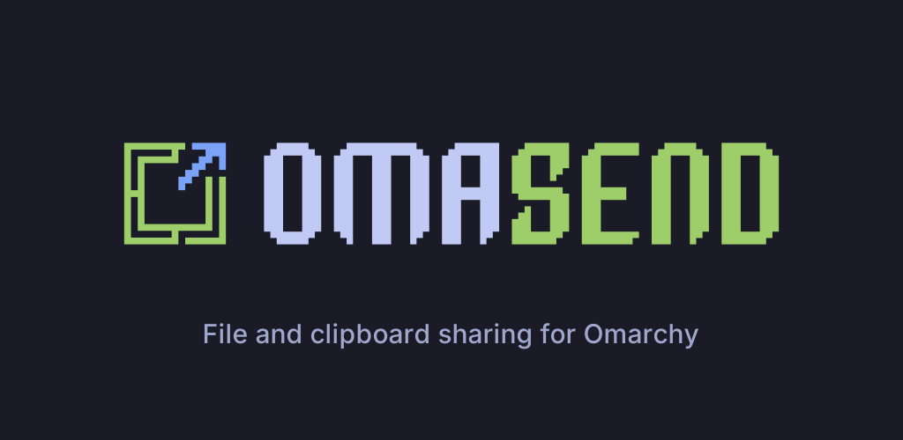

# Android İçin OmaSend

<p align="center">
  
</p>

<p align="center">
  <a href="https://github.com/ozdil/omasend-android/releases"></a>
  <a href="https://play.google.com/apps/testing/io.omarchy.omasend"></a>
  <a href="https://groups.google.com/g/omasend-testers"></a>
  <a href="https://github.com/ozdil/omarchy-omasend"></a>
  <a href="https://buymeacoffee.com/ozdil"></a>
  <a href="LICENSE"></a>
</p>

> **OmaSend for Omarchy: Android telefonunuz, Omarchy Linux ve tarayıcı arasında dosya ve pano gönderin. Bir kez QR kodla eşleştirin; cihazlarınız arasındaki her şey uçtan uca şifrelenir. İsteğe bağlı anonim OmaID ile kendi cihazlarınız internet üzerinden de bağlanır. Kayıt yok, e-posta yok, takip yok.**

---

## 2.0.9 ile gelenler (versionCode 109)

**Yeni**
- **OmaID hesabı.** Tüm cihazlarınız için tek, anonim, 16 haneli numara (Mullvad tarzı): e-posta, ad ya da telefon numarası yok. Numara telefondan çıkmaz; `id.omaid.app` kayıt sunucusu yalnızca Argon2id ile türetilmiş bir kimliği ve uçtan uca şifreli, imzalı cihaz listesini saklar. Yeni cihazı numara ve tek seferlik onayla (iki ekranda aynı 6 haneli kod) ya da katılım QR'ını (`https://omaid.app/j#…`) okutarak ekleyin.
- **İnternet üzerinden.** OmaID varsa aynı ağda olmayan kendi cihazlarınız şifreli iroh röleleri üzerinden bağlanır, mümkün olduğunda doğrudan bağlantıya geçer. 4 GiB'tan büyük aktarımlar doğrudan bağlantıyı bekler.
- **Ortak pano, son kopya kazanır.** Son kopyanız kendi cihazlarınıza sessizce ulaşır; 2 dakikadan eski ya da daha yenisi olan kopyalar atılır. Hızlı Ayarlar kutucuğu: **Pano**.
- **Tek renk.** Telefonun açık/koyu temasını ve Material You tonlarını izleyen tek renkli OmaSend logosu ve arayüz; bir cihaza dokun, gönder.

**Hata düzeltmeleri**
- Telefondan PC'ye gönderim artık "Permission denied (os error 13)" hatası vermiyor.
- "Galeriden" seçeneği resim olarak kaydedilmiş eşleştirme QR'ıyla eşleşiyor.
- Reddedilen aktarım beklemeden reddi gösteriyor.
- Hızlı Ayarlar kutucuğunun adı kesilmiyor; "1 cihaz" doğru yazılıyor; Hakkında metni güncel.

Tüm geçmiş: [masaüstü CHANGELOG](https://github.com/ozdil/omarchy-omasend/blob/next/CHANGELOG.md).

---

## Resmi Google Play Kapalı Beta

Android için OmaSend, doğrulanmış SHA-256 uygulama imzası ve **Play Protect** güvenlik taramasıyla resmi olarak **Google Play** üzerinden dağıtılmaktadır.

### Kurulum ve Test Ekibine Katılma (3 Basit Adım):

1. **Test Topluluğuna Katılın (Google Grubu):**  
   [OmaSend Test Ekibi Google Grubuna Katıl](https://groups.google.com/g/omasend-testers)  
   *(Android telefonunuzda kullandığınız Google hesabıyla "Gruba katıl" butonuna tıklayın).*

2. **Test Programını Onaylayın (Google Play Web):**  
   [Google Play Üzerinde Test Kullanıcısı Ol](https://play.google.com/apps/testing/io.omarchy.omasend)  
   *("Test kullanıcısı ol" / "Become a tester" butonuna tıklayın).*

3. **Google Play Store Üzerinden Yükleyin:**  
   [Google Play'de OmaSend İndir](https://play.google.com/store/apps/details?id=io.omarchy.omasend)  
   *(Doğrudan Android telefonunuzda bağlantıyı açarak Play Store üzerinden kurun).*

---

## Yetenekler ve Özellikler

- **Cihaza dokun, gönder:** fotoğraf, video, belge ve arşivleri herhangi bir uygulamadan sistem paylaşım menüsüyle ya da OmaSend içinden seçerek gönderin.
- **Cihaz anahtarlarıyla QR eşleşme:** her telefonun Android Keystore ile korunan kendi Ed25519 anahtarı vardır. Eşleşmiş cihazlar QUIC + TLS 1.3 (ortak Rust çekirdeği `omasend-core`) üzerinden konuşur; dosyalar BLAKE3 ile doğrulanır ve kaldığı yerden devam eder.
- **Kendi cihazlarım ve başkalarınınkiler:** kendi cihazınız olarak eşleştirdikleriniz aktarımları otomatik kabul eder ve panoyu paylaşır; başkalarınınkiler her zaman onayınızı bekler.
- **OmaID:** cihaz listenizi eşitleyen ve cihazlarınızı internet üzerinden bağlayan isteğe bağlı anonim hesap (yukarıya bakın).
- **Pano:** kendi cihazlarınızdan metin, en yeni kopya kazanır; Android 13+ tarafından hassas işaretlenen pano içerikleri (parola yöneticileri) asla paylaşılmaz.
- **Yakındaki cihazlar:** aynı ağdaki eşleştirilmemiş cihazlar eski HTTP yoluyla (port `53317`), her zaman onayla çalışmaya devam eder. Bu yol şifreli değildir; güvendiğiniz ağlarda kullanın.

---

## Güvenlik

- **Eşleşmiş cihazlar arasında uçtan uca şifreleme:** her cihazın anahtarına bağlı QUIC/TLS 1.3; eşleşmiş cihazlar için sessizce şifresiz HTTP'ye düşme yok.
- **Kişisel veri yok:** kayıt yok, analiz yok. OmaID kayıt sunucusu numaranızı, adlarınızı ya da dosyalarınızı görmez; röleler yalnızca şifreli trafik taşır.
- **Doğrulanmış derlemeler:** her Gradle bağımlılığı `gradle/verification-metadata.xml` içinde SHA-256 ile sabitlenmiştir.

---

## Omarchy Linux Masaüstü ve Web Entegrasyonu

- **Masaüstü Eklenti Deposu:** [ozdil/omarchy-omasend](https://github.com/ozdil/omarchy-omasend)
- **Web İstemci Deposu:** [ozdil/omasend-web](https://github.com/ozdil/omasend-web)
- **Motor Protokolü:** OmaSend masaüstü motoru (`omasend-engine`) 2.0.9 ile uyumludur: QUIC için UDP `53318`, eski HTTP için `53317`.

---

## Kaynak Koddan Derleme

```bash
# Depoyu klonlayın
git clone https://github.com/ozdil/omasend-android.git
cd omasend-android

# Debug APK derleyin
./gradlew assembleDebug

# Yayınlama Paketi (AAB) derleyin
./gradlew bundleRelease

# Bağlı telefona ADB ile yükleyin
adb install -r app/build/outputs/apk/debug/app-debug.apk
```

---

## Lisans

Bu proje **MIT Lisansı** ile lisanslanmıştır. Detaylar için [LICENSE](LICENSE) dosyasına bakın.
